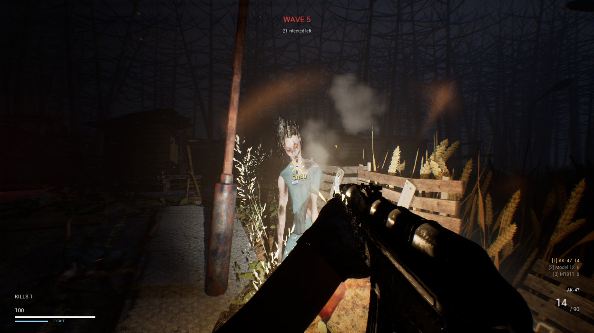
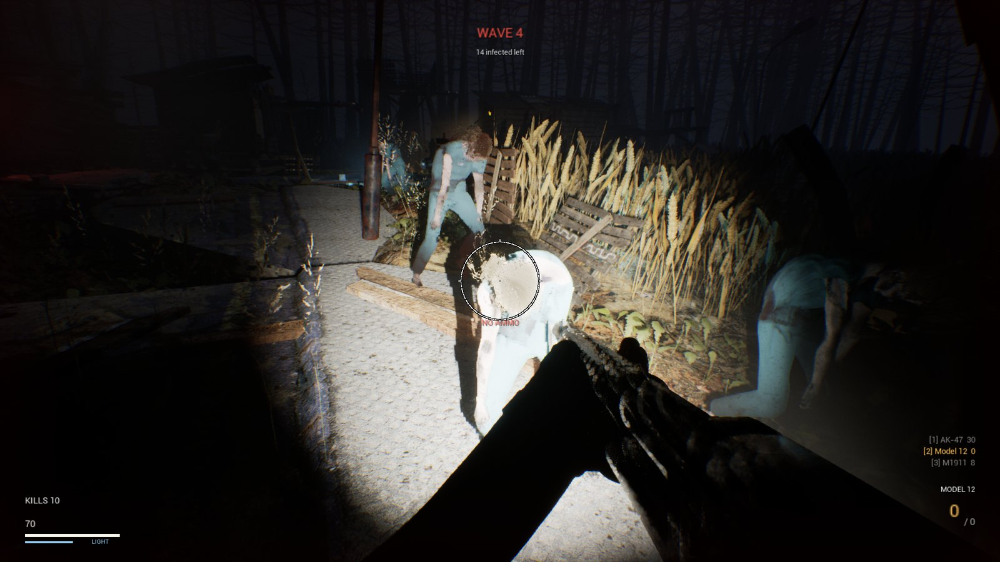
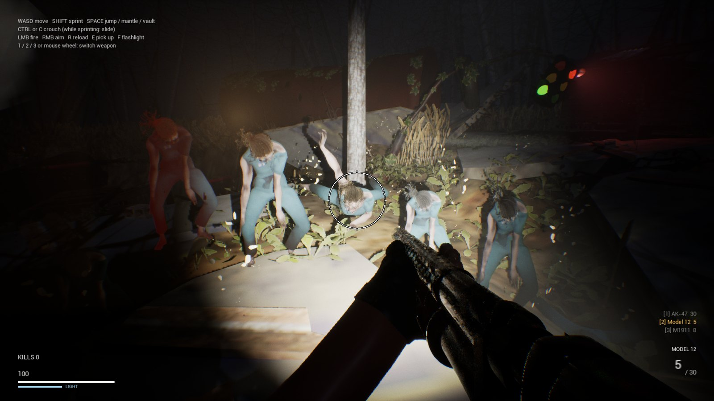
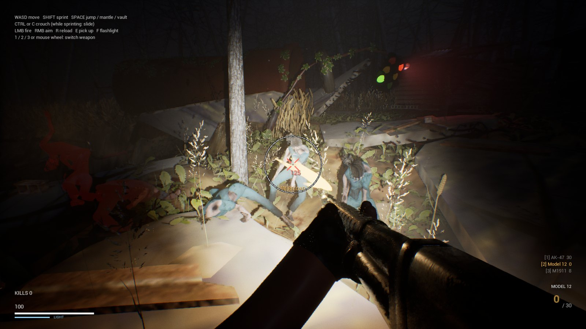
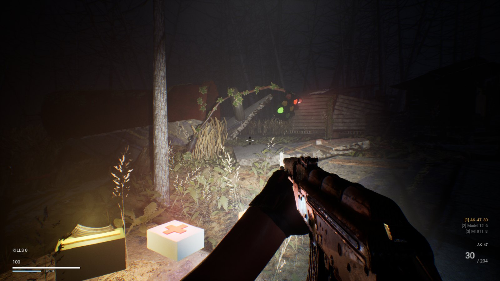
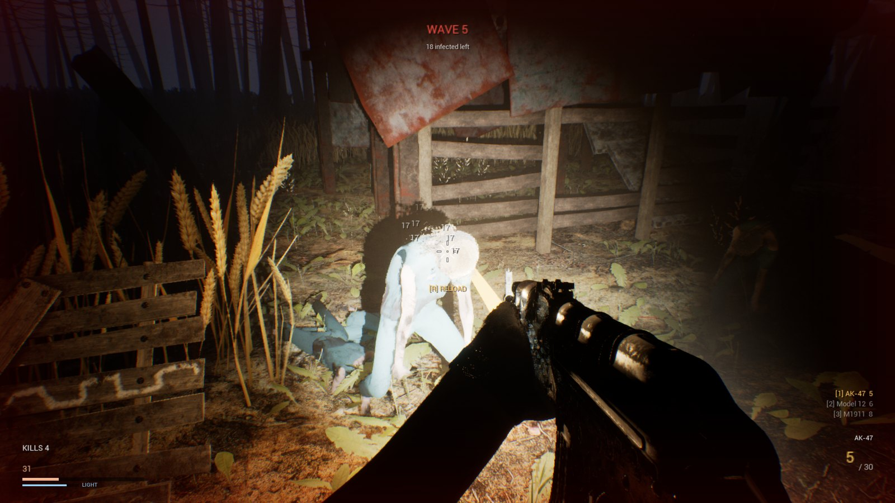
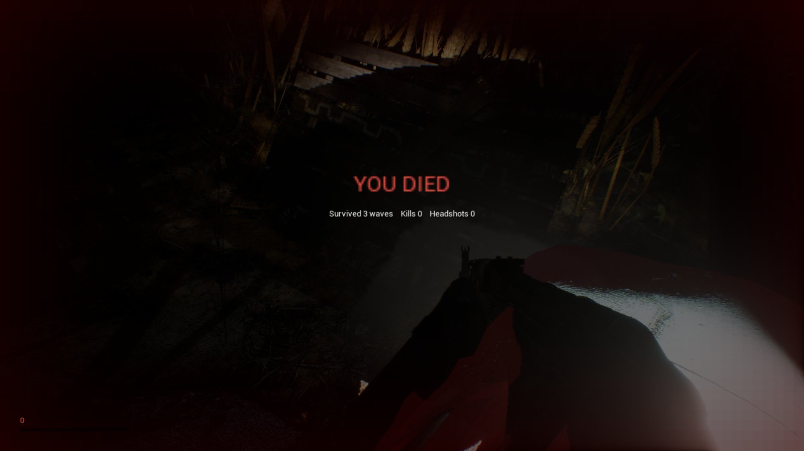
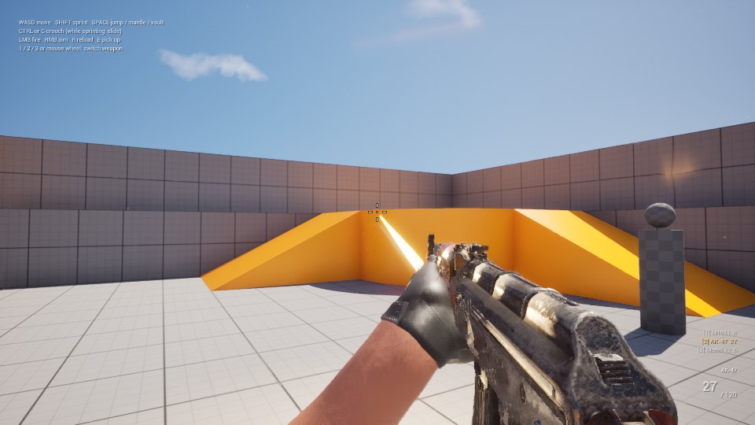
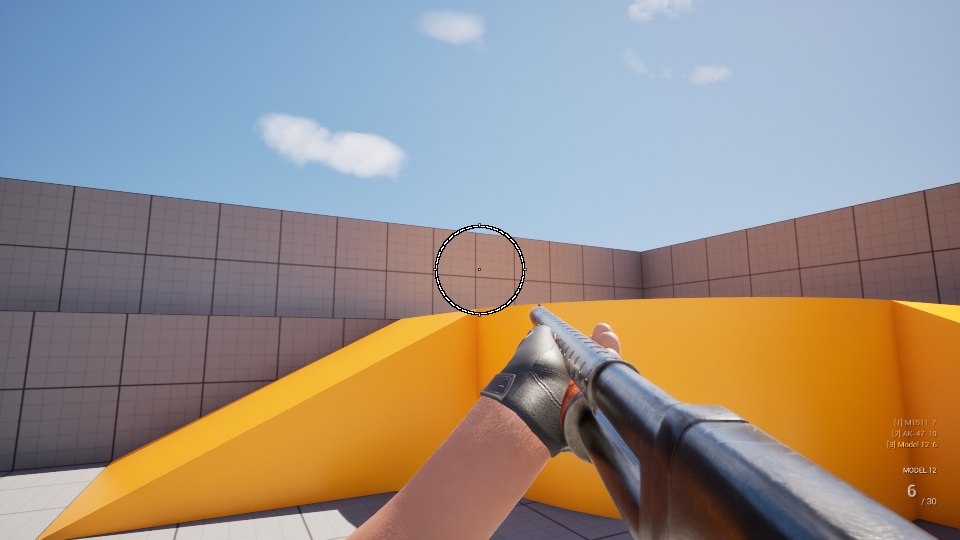

# Zombie Survival FPS

A first person horror survival game built with **Unreal Engine 5.7** and **C++**. You hold out in a foggy camp in a
dead forest at night, with a flashlight that runs out, three weapons, and waves of zombies that grow in number,
speed and toughness.

| | |
| --- | --- |
|  |  |
| *Surrounded on wave 4* | *Zombies lined up with `-ZombieShowcase`* |
|  |  |
| *Pump shotgun up close* | *Ammo and first aid* |
|  |  |
| *Badly hurt* | *Death screen* |

## Contents

- [Zombie survival](#zombie-survival)
- [Shooter features](#shooter-features)
- [Controls](#controls)
- [Getting started](#getting-started)
- [Code overview](#code-overview)
- [Testing flags](#testing-flags)
- [Credits](#credits)

## Zombie survival

The default map is `Content/Zombies/Maps/Lvl_ZombieArena`.

- **Zombies** (`AZombieCharacter`, `BP_Zombie`) come in six types:
  - walkers;
  - runners;
  - brutes, which charge and knock you back;
  - crawlers, which drag themselves through the grass;
  - screamers, which keep their distance and shriek to frenzy the horde and call more zombies;
  - stalkers, tall black figures with red eyes that freeze while you look at them, strike from behind and make your flashlight fail.

  From wave 2, some of the bodies lying around the camp are zombies playing dead. Each type has its own glowing eyes, skin tint and voice. They have per-bone hit reactions, a stagger when they take heavy damage, headshots, a ragdoll on death, and their own sounds.
- **AI** (`AZombieAIController`): the zombies see in a cone in front of them and hear gunshots. A zombie that spots you screams and alerts the horde around it. They come at you on flanking paths to surround you, and only a few attack at once (attack slots in `UZombieCoordinator`) while the others circle and wait. They lunge when close, avoid each other in a crowd, search where they last saw you, and get themselves unstuck.
- **Animation** (`UZombieAnimInstance`): native blending of idle, walk and run matched to ground speed, plus one shot attacks, screams and hit reactions. No Anim Blueprint is needed.
- **Waves** (`AZombieWaveDirector`, `BP_ZombieWaveDirector`): zombies spawn out of sight at the `ZombieSpawn` points. The music switches between calm and combat.
- **Supplies** (`AZombiePickup`, `BP_ZombiePickup`): after each wave, ammo boxes, a first aid kit and a battery are left on the ground around you. Dead zombies sometimes drop one too. Walk over an item to take it; it stays if you don't need it.
- **Flashlight battery**: the light drains while it is on. When the battery is low, the light dims and flickers. At zero it goes out until you pick up a battery. A small bar under the health shows the charge.
- **Gore and kill feel**: shotgun blasts tear off arms (even on a living zombie) and legs (on the dead), and blow heads off. Brutal kills freeze the moment for a split second. Zombies make footsteps that you can hear; brutes stomp, stalkers are almost silent and crawlers drag themselves over the ground.
- **Player**: health with regeneration, a camera kick when you are hit, a red vignette, a damage direction indicator, a heartbeat at low health, death and restart.
- **Horror events**: screams far away in the forest, lamps that die for a moment, whispers right behind you, and a jumpscare sting when something hits you from out of view.

## Shooter features

| | |
| --- | --- |
|  |  |

The shooting range and traversal course are in `Content/FirstPerson/Lvl_FirstPerson`.

- **Data-driven weapons** – every weapon is a child Blueprint of `AGunBase` plus a `UWeaponDataAsset`.
  Fire rate, fire mode, range, recoil pattern, spread, FX, sounds and animations are all configured in data.
- **Hitscan firing** from the center of the screen with single and automatic fire modes and a
  fire rate that is enforced between trigger presses.
- **Pattern-based recoil** – each shot pushes the view along a per-weapon recoil pattern; the pattern
  resets after the trigger is released.
- **Dynamic crosshair** – spread grows per shot and with movement speed, then recovers over time.
- **Weapon feedback** – slide kick-back, muzzle flash, Niagara tracers, impact actors, camera shake and
  a delayed muzzle smoke puff after the last shot.
- **Look-at pickup** – a trace from the camera detects weapons in front of the player and shows an
  interaction prompt.
- **Animation layers** – each weapon links its own anim layer (`ALI_Weapon`) to the character's
  Animation Blueprint, with left hand IK driven by a socket on the weapon mesh.
- **Sprint / fire interplay** – holding the trigger cancels the sprint, and the weapon only starts
  firing once the character has slowed down to walking speed.

### Weapons and gunplay

- **Inventory** – up to three weapons; `1` `2` `3` or the mouse wheel switch between them. Picking up a
  weapon with a full inventory swaps it with the held one.
- **Ammo and reloading** – magazine + reserve ammo, tactical and (longer) empty reloads with a timed
  sound timeline (mag out, mag in, charge), per-shell reloads for the shotgun that the trigger can
  interrupt, automatic reload when the magazine runs dry.
- **Aim down sights** – per-weapon FOV zoom, slower movement, tighter spread, softer recoil and a
  look sensitivity that scales with the zoom.
- **Bullet spread** – the crosshair gap is the real deviation cone; it grows with shots, movement and
  jumping. Shotguns fire multiple pellets.
- **Recoil feel** – pattern recoil on the view, partial recovery after the burst, plus a procedural
  camera kick and FOV punch that spring back.
- **Damage and feedback** – point damage with headshots, physics impulses, hit marker (white / yellow
  headshot / red kill), hit sounds and floating damage numbers.
- **Sounds** – randomised gunshots with tails, reload foley, equip / aim foley, dry fire, shotgun pump.

### Movement

- **Sprint** forward only; aiming or holding the trigger cancels it.
- **Slide** – crouch while sprinting. Speed boost (with cooldown), slopes accelerate it, jumping out of a
  slide keeps the momentum. Landing while holding crouch slides straight away.
- **Mantle / vault** – jump into a ledge to climb it (up to ~2.3 m); low thin obstacles are vaulted
  without losing speed. Ledges are also grabbed automatically when pushing into them in the air.
- **Jump assists** – coyote time and jump buffering.
- **Camera feel** – sprint / slide FOV, strafe and slide roll, landing and mantle dips, subtle head bob,
  footsteps and landing sounds.

## Controls

| Action | Key |
| ------ | --- |
| Move | `W` `A` `S` `D` |
| Look | Mouse |
| Sprint | `Left Shift` |
| Jump / mantle / vault | `Space` |
| Crouch / slide | `Left Ctrl` or `C` |
| Fire | `Left Mouse` |
| Aim down sights | `Right Mouse` |
| Reload | `R` |
| Switch weapon | `1` `2` `3` / mouse wheel |
| Pick up / swap weapon | `E` |
| Flashlight | `F` |

Supplies are taken by walking over them.

## Getting started

**Requirements:** Unreal Engine 5.7, and Visual Studio 2022 or JetBrains Rider with the
"Game development with C++" workload.

> **The clone is not playable on its own.** It holds the C++ code, the Blueprints, the maps and the data assets.
> The packs below are not included, because the Fab license does not allow sharing their files in a public
> repository. Without them, meshes, animations and sounds are missing.

1. Clone the repository.
2. Add these packs to the project from Fab, in the folders shown.
3. Right click `FirstPersonProject.uproject` → **Generate Visual Studio project files**.
4. Build the `FirstPersonProjectEditor` target (Development Editor, Win64), open the project and press **Play**.

| Folder in `Content/` | Pack | Used for |
| -------------------- | ---- | -------- |
| `ZombieFemale` | Zombie Female: Nurse | Zombie model |
| `ZombieAnimationPack` | Zombie Animation Pack: Standard | Zombie animations |
| `PostApocalypticSandbox` | Post-Apocalyptic Sandbox | Arena |
| `Vefects` | Vefects Free Blood VFX | Blood |
| `SoundsOfHorror` | Sounds of Horror | Horror sounds |
| `HorrorThriller_Music_Loops` | Horror/Thriller Music Loops | Music |
| `MonsterRoarsAndGrowls` | Monster Roars & Growls | Zombie voices |
| `Thunder_Sounds` | Thunder sounds | Ambience |
| `HealthDamageSFX` | Health and damage sounds | Getting hurt |
| `FreeWeaponSFX` | Free Weapon Sound Effects (SoundLab1) | Weapon sounds |
| `FootstepsMiniPack` | Footsteps Mini Sound Pack | Footsteps |
| `FirstPersonRifleAnimations` | First Person Rifle Animation | Arms, rifle and shotgun animations |
| `Fab/Model_12_Pump_Action_Shotgun_Free_Standard` | Model 12 pump action shotgun | Shotgun |
| `M1911` | M1911 pistol | Pistol |
| `1CPP`, `MetaHumans` | First person pistol animations and their skeleton | Pistol animations |
| `DynamicFPS` (`Sounds`, `Blueprints`) | Dynamic FPS | Sounds and impact Blueprints |

A few assets made from those packs are left out too:

- `Content/Zombies/Animations`: retarget `ZombieAnimationPack` with `Content/Zombies/Retarget/RTG_PackToNurse`
  (the results are named `anim_*_Nurse`).
- `Content/Game/Character/FirstPerson/Pistol/AS_*`: retarget the pistol animations with
  `Content/Game/Character/FirstPerson/Retarget/RTG_MetaHumanToFPArms`.
- `SW_FleshHit_*`, `SW_HeadHit_*` and `SW_KillThunk` in `Content/Zombies/Audio/Impacts`: short impact sounds.

The EngineWire editor plugin is optional; the project opens without it.

## Code overview

All gameplay code lives in `Source/FirstPersonProject`.

| Class | Responsibility |
| ----- | -------------- |
| `APlayerCharacter` (`Player/`) | Input, interaction. Movement (sprint, slide, jump assists, footsteps) lives in `PlayerCharacterMovement.cpp`, inventory / firing / ADS / reload in `PlayerCharacterWeapons.cpp`. |
| `UTraversalComponent` (`Player/`) | Ledge detection and procedural mantle / vault moves. |
| `UCameraFeelComponent` (`Player/`) | FOV, roll, recoil kick, dips and head bob on the camera. |
| `UViewmodelComponent` (`Player/`) | First person arms: animated hands and gloves on the camera driven by an Anim Blueprint (idle, walk, sprint, jump, aim), weapon montages (draw, fire, reload), and a light weight layer (view lag, landing dip, shot kick). First person rendering keeps the weapon out of walls. |
| `AGunBase` (`Gun/`) | Fire rate, ammo, reloading, pellets, damage, recoil, spread, slide kick and all firing FX. Handles its own held / holstered / world state. |
| `UWeaponDataAsset` (`Data/`) | All tuning values for a weapon type (firing, damage, ammo, handling, sounds, feedback, recoil, spread). |
| `ADamageTarget` (`Gameplay/`) | Shooting range dummy with a headshot zone, hit flash, knock-down / respawn and optional strafing. |
| `AShooterHUD` (`UI/`) | Canvas HUD: ammo, weapon slots, reload bar, hit markers, damage numbers. |
| `UInteractPromptWidget` (`UI/`) | Interaction prompt shown while looking at a weapon. |
| `AFirstPersonProjectPlayerController` | Adds the input mapping contexts and the camera manager. |
| `AFirstPersonProjectCameraManager` | Clamps the view pitch. |
| `AZombieCharacter` (`Zombie/`) | Zombie body: health, types, attacks, hit reactions, gore, footsteps, ragdoll. |
| `AZombieAIController` (`Zombie/`) | Senses and behavior: wander, investigate, alert, chase, search, dormant, and per-type tactics. |
| `UZombieCoordinator` (`Zombie/`) | World subsystem shared by the horde: attack slots, alerts, frenzy. |
| `UZombieAnimInstance` (`Zombie/`) | Native animation blending, no Anim Blueprint. |
| `AZombieWaveDirector`, `AZombieGameMode` (`Zombie/`) | Waves, spawning, supplies, music, horror events, death and restart. |
| `AZombiePickup` (`Zombie/`) | Ammo, first aid and battery pickups. |

### Adding a new weapon

1. Create a `UWeaponDataAsset` and fill in the firing, recoil, crosshair, FX and animation values.
2. Create a Blueprint child of `AGunBase`, assign the meshes and the data asset.
3. Make sure the weapon mesh has a `MuzzleSocket` and a `LeftHandSocket` (used by the left hand IK).
4. Place it in the level – it can be picked up right away.

### First person weapons

Each weapon data asset (`Content/Game/Guns/Data`) has a **First Person** section:

- `ViewMesh` / `ViewAnimClass`: the animated weapon (bolt, magazine) shown in the hands and in the world.
- `ArmsAnimClass` and the `Arms*Montage` fields: the arm animation set. The rifle and shotgun use the
  *First Person Rifle Animation* pack (`Content/FirstPersonRifleAnimations`), the pistol uses
  `Content/Game/Character/FirstPerson/ABP_FP_Pistol` with pistol animations retargeted onto the same arms
  (`Retarget/RTG_MetaHumanToFPArms`).
- `AttachSocketName` / `AttachOffset` / `ViewMeshOffset`: how the model sits in the right hand.

## Testing flags

Add these to the game's command line. Screenshots go to `Saved/Screenshots/`. The flags do nothing in shipping builds.

| Flag | What it does |
| ---- | ------------ |
| `-ZombieCapture` | A bot plays the waves, logs the state (`ZOMBIE` lines), takes screenshots and quits |
| `-ZombiePassive` | The bot only watches and lets the zombies attack |
| `-ZombieWeapon=N` | The bot uses weapon slot N |
| `-ZombieShotInterval=S` | The bot takes a 1080p screenshot every S seconds |
| `-ZombieBattery=0.1` | The bot starts with that flashlight charge |
| `-ZombieStartWave=N` | Starts at wave N |
| `-ZombieShowcase` | Lines up the zombie types, standing still |
| `-ZombieSupplies` | Lays out the supplies around the player |
| `-ViewmodelCapture` | Takes screenshots of every weapon pose |
| `-FeelCapture -benchmark -fps=60` | Scripted look, move and fire test that logs the weapon springs (`FEEL` lines) |

## Credits

Third party assets belong to their respective authors:

- Fab packs: see the table in [Getting started](#getting-started)
- Weapon models `GUN_Pistol_Orange` and `SS2_V5_Assault_Rifle` (Fab)
- Impact and muzzle effects from the Dynamic FPS pack
- Paragon: Lt. Belica, Lyra Starter Game animations, First Person template, mannequins and Level Prototyping assets – Epic Games
- Quixel Megascans material presets
